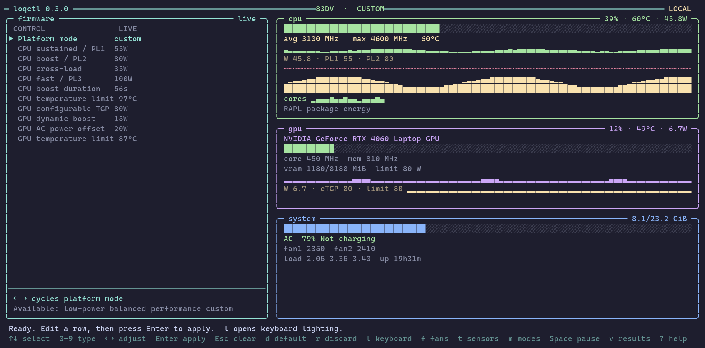

# loqctl

A btop-style terminal dashboard and CLI for Lenovo LOQ laptops on Linux. It shows live CPU, NVIDIA GPU, memory, battery and fan readings next to the firmware power and thermal limits, and lets you change those limits with read-back verification. Keyboard RGB is driven through [LegionAura](https://github.com/nivedck/LegionAura). UI colors come only from your terminal's ANSI palette.



## Requirements

| Need | Details |
| --- | --- |
| OS | Linux only (uses `/sys`, `/proc`, `SO_PEERCRED`, `curses`) |
| Python | 3.10+ (standard library only, no `pip install` needed; see `requirements.txt`) |
| Kernel | Lenovo WMI drivers `lenovo-wmi-gamezone` and `lenovo-wmi-other`. You need `/sys/class/firmware-attributes/lenovo-wmi-other*/` to exist. Linux 6.17 or newer is required for these drivers; check your own kernel with the command below. |
| Privileges | `sudo` for writing firmware settings. Reading works without it, except CPU power (RAPL), which needs root. |
| Terminal | At least 72×20 (96×24 recommended), UTF-8 locale |
| Optional | `nvidia-smi` at `/usr/bin/nvidia-smi` for GPU data; `legionaura` for keyboard RGB |

Check that your machine is supported:

```sh
ls /sys/class/firmware-attributes/        # expect lenovo-wmi-other-0
cat /sys/class/platform-profile/*/name    # expect lenovo-wmi-gamezone
cat /sys/class/platform-profile/*/choices # expect a "custom" entry
```

If the first command fails, loqctl can still show telemetry but cannot change firmware limits.

## Install

```sh
git clone <this repository> && cd loqctl
install -Dm755 loqctl.py ~/.local/bin/loqctl   # make sure ~/.local/bin is on PATH
loqctl --version
```

If you run loqctl with sudo (including for the dashboard's writes), install it to a root-owned path instead:

```sh
sudo install -Dm755 loqctl.py /usr/local/bin/loqctl
```

When sudo runs a user-writable file, any process running as you can gain root by editing it.

Or run it in place with `python3 loqctl.py`.

## Dashboard

```sh
loqctl
```

| Key | Action |
| --- | --- |
| `↑↓` / `j k` | Select a control |
| `←→` / `- +` | Stage one step (on the mode row: cycle modes) |
| `Enter` | Type a value, `Enter` stages it |
| `a` | Apply staged edits (mode first, each write verified) |
| `d` | Stage the firmware default for the selected control |
| `r` | Discard staged edits |
| `l` | Keyboard lighting panel |
| `Space` | Pause telemetry |
| `v` | Reopen the last apply results |
| `?` | Help |
| `q` | Quit |

Power and temperature limits only take effect in **custom** mode. The other modes (low-power, balanced, performance) are managed by the firmware. To tune limits, stage `custom` on the *Platform mode* row, then edit the limits and press `a`.

Nothing is written on start or exit.

### Sudo and privileges

Firmware writes need root. You have two options:

1. **Per-write sudo (default).** The dashboard suspends itself and runs `sudo` for each write. Your sudo credential cache applies, so you are prompted at most once per cache period.
2. **Privileged server (recommended for frequent tuning).** Run `sudo loqctl serve` in another terminal. The dashboard then connects to it automatically and never needs to leave the screen. See [Local HTTP API](#local-http-api).

### Keyboard panel (`l`)

| Key | Action |
| --- | --- |
| `1`–`4` | Select zone |
| `↑↓` | Choose H / S / V channel |
| `←→` | Nudge channel (`H` / `L` for fine steps) |
| `e` | Cycle effect: static → breath → wave → hue → off |
| `b` | Toggle brightness low/high |
| `w` | Wave direction ltr/rtl |
| `c` | Copy the selected zone color to all four |
| `Space` | Toggle live apply |
| `Enter` | Apply via `legionaura` |
| `Esc` | Back |

Zone swatches in the terminal are the nearest ANSI color; the keyboard shows the real RGB. Settings are read from `~/.config/legionaura/config.json`.

## CLI

Read commands print JSON.

```sh
loqctl status
loqctl metrics
loqctl capabilities
loqctl mode                          # current mode and available modes
sudo loqctl mode custom
sudo loqctl set ppt_pl1_spl 50
```

`sudo` may not find a `~/.local/bin` install; install to `/usr/local/bin` as described above so `sudo loqctl ...` works and the file is root-owned.

Writes check the firmware's min, max and step, write once, then read the value back. `set` is refused unless the mode is `custom`.

| Attribute | Meaning | Unit |
| --- | --- | --- |
| `ppt_pl1_spl` | CPU sustained power limit | W |
| `ppt_pl2_sppt` | CPU boost power limit | W |
| `ppt_cpu_cl` | CPU cross-load power limit | W |
| `ppt_pl1_tau` | CPU boost duration | s |
| `cpu_temp` | CPU temperature limit | °C |
| `gpu_nv_ctgp` | GPU configurable total graphics power | W |
| `gpu_nv_ppab` | GPU power performance aware boost | W |
| `gpu_nv_ac_offset` | GPU AC power baseline offset | W |
| `gpu_temp` | GPU temperature limit | °C |

Only attributes the firmware actually exposes appear. Ranges come from the running firmware; a step of `0` means any integer. Defaults are the firmware's values for the active mode. Read-back confirms the configuration, not real workload wattage.

### Keyboard CLI

```sh
loqctl kb                                   # status
loqctl kb static f2760a
loqctl kb static ff0000 00ff00 0000ff ffffff --brightness 2
loqctl kb breath aa00ff --speed 2 --brightness 1
loqctl kb wave ltr --speed 3
loqctl kb hue --speed 2
loqctl kb brightness 2
loqctl kb off
loqctl kb apply
```

## Local HTTP API

```sh
sudo loqctl serve
```

Serves HTTP over a Unix socket at `/run/loqctl-UID/control.sock`. Only that user and root can connect (checked with peer credentials); the socket is mode `0600` in a root-owned directory. There is no TCP listener. Stop it with Ctrl+C. If a server crashed and left a socket behind, remove the stale `control.sock` manually before restarting.

```sh
curl --unix-socket /run/loqctl-$(id -u)/control.sock http://localhost/v1/status
curl --unix-socket /run/loqctl-$(id -u)/control.sock \
  -H 'Content-Type: application/json' -d '{"mode":"custom"}' \
  http://localhost/v1/mode
```

| Method | Endpoint | Body |
| --- | --- | --- |
| GET | `/v1/status` | Firmware and telemetry |
| GET | `/v1/metrics` | Telemetry (about 1 Hz) |
| GET | `/v1/capabilities` | Modes, bounds, defaults |
| POST | `/v1/mode` | `{"mode":"custom"}` |
| POST | `/v1/attributes/NAME` | `{"value":50}` |

Use `--socket PATH` to point the CLI or dashboard at a specific socket.

## Where the readings come from

- CPU temperature: hottest sensor from `coretemp`, `k10temp` or `zenpower`. Power: RAPL package energy deltas (needs root). Clocks: cpufreq. Utilization: `/proc/stat`.
- GPU: `nvidia-smi` (querying can wake a sleeping GPU). The dashboard shows the first GPU; JSON lists all.
- RAM: `/proc/meminfo`. Battery, AC and fans: sysfs, when present.
- Missing readings show as `N/A` / `null`.

Firmware control uses the kernel's [Other Mode](https://www.kernel.org/doc/html/next/wmi/devices/lenovo-wmi-other.html) and [Gamezone](https://www.kernel.org/doc/html/next/wmi/devices/lenovo-wmi-gamezone.html) drivers. loqctl makes no raw EC writes and only writes the attributes listed above.

## Troubleshooting

| Symptom | Likely cause |
| --- | --- |
| "No firmware attributes exposed" | Kernel lacks the Lenovo WMI drivers, or your model isn't supported by them |
| "Select custom mode before changing firmware limits" | Limits are only writable in `custom` mode |
| "RAPL needs root access" | CPU power reads are root-only; run `sudo loqctl serve` or `sudo loqctl` |
| "Socket already exists" | Stale socket from a crashed server; delete it and retry |
| "legionaura not found" | Install LegionAura (AUR package `legionaura` on Arch) |
| GPU shows offline | `nvidia-smi` missing, not at `/usr/bin/nvidia-smi`, or driver not loaded |

## Known limitations

- Linux and Lenovo-WMI hardware only. Not tested on other distros or other Lenovo models.
- Absolute paths for `nvidia-smi` and `legionaura` (`/usr/bin/...`) may not match NixOS or custom installs.
- Privilege escalation is `sudo` only (no `doas`/`pkexec`).
- Keyboard RGB depends on the third-party `legionaura` tool.

## Development

```sh
python3 -m unittest discover -s tests -v
python3 loqctl.py status
```

Tests use a temporary simulated sysfs and never touch real laptop settings.

## License

GPL-3.0-or-later, see `LICENSE`. Third-party credits are in `NOTICE`.
